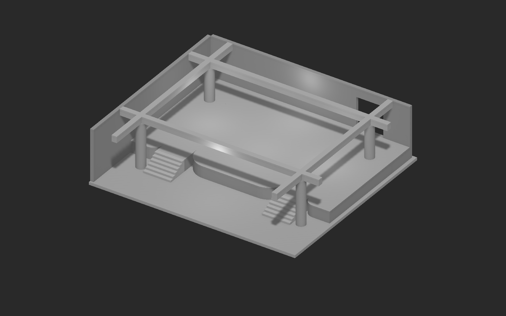

# Punisher Unity Prototype

An unofficial third-person gameplay prototype in Unity. It includes a character controller, a Cinemachine shoulder camera, animation and hand IK, and an industrial interior graybox for level design.

## Open the project

1. Clone the repository and add its root folder to Unity Hub.
2. Open the project with Unity **6000.6.0f1**, as recorded in [ProjectVersion.txt](ProjectSettings/ProjectVersion.txt). Unity resolves URP, Cinemachine, and the Input System from [Packages/manifest.json](Packages/manifest.json).
3. Open [SampleScene.unity](Assets/Scenes/SampleScene.unity) and press Play to try the character and camera. Open [MicroLair_Graybox.unity](Assets/Scenes/MicroLair_Graybox.unity) to inspect the separate level blockout.

## Sample Scene controls

| Input | Action |
| --- | --- |
| W | Walk forward |
| Mouse | Turn and look |
| Right mouse button | Aim |
| Left mouse button | Fire |
| Esc | Release the cursor. Click the Game view to capture it again. |

## Project layout

- [Assets/Scripts](Assets/Scripts) contains the character controller, camera, animation, hand IK, and shooting logic.
- [Assets/Environment/MicroLair](Assets/Environment/MicroLair) contains the graybox meshes, materials, and editor tools.
- [Documentation/MicroLair](Documentation/MicroLair) includes the [graybox notes](Documentation/MicroLair/graybox-scene.md), [layout validation](Documentation/MicroLair/graybox-validation.txt), and [structural plan](Documentation/MicroLair/structural-reconstruction.md).

## History

The project was imported from Unity Version Control. The imported commit messages reference the original changeset numbers. The [earlier portfolio snapshot](https://github.com/ShariqKazmi25/punisher-unity-prototype/tree/a915e737276a37c7108d34d6b69d315c75fe3f78) remains in the Git history.
