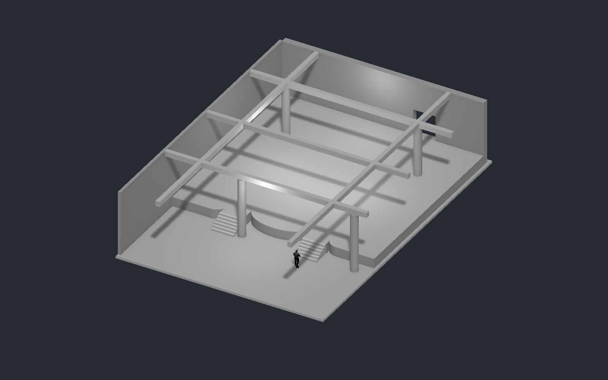

# Punisher · Third-Person Unity Prototype

An in-progress, unofficial fan project exploring third-person gameplay programming and level iteration in Unity. This portfolio snapshot contains the C# gameplay and editor scripts, graybox previews, and recorded validation results. The full Unity scene, imported character, animations, and other third-party assets are excluded, so this snapshot is for code review and does not include a playable build.

## Systems to review

| System | Implementation |
| --- | --- |
| Character locomotion | [`PunisherMovement.cs`](src/Runtime/PunisherMovement.cs) drives a `CharacterController`, updates Animator states, and synchronizes movement ramps with animation transitions. |
| Third-person camera | [`ThirdPersonCameraController.cs`](src/Runtime/ThirdPersonCameraController.cs) handles mouse look, focus and cursor capture, and Cinemachine shoulder-camera transitions. |
| Animation and gameplay | [`RifleHandIK.cs`](src/Runtime/RifleHandIK.cs) handles hand IK, [`RifleWeaponAnimation.cs`](src/Runtime/RifleWeaponAnimation.cs) drives clip playback, and [`PunisherShooter.cs`](src/Runtime/PunisherShooter.cs) handles in-game hit detection and feedback. |
| Level tools | [`src/Editor`](src/Editor) contains Unity editor scripts for building the graybox, wiring the gameplay rig, updating geometry across revisions, and checking scene references and collision. |

The source project uses Unity `6000.6.0f1`, C#, the Input System, Cinemachine, and URP. The editor scripts reference assets and scenes in the original Unity project.

## Development and testing

The graybox evolved through several revisions of the stairs, upper walkways, corridor lengths, and ceiling clearance. Unity editor checks sampled the character capsule against the revised floors and overhead geometry.

- [Play Mode smoke test](docs/gameplay-playtest.txt) records stair traversal, grounding, camera collision, and in-game hit detection with simulated input. This run predates the later structural changes.
- [Revision E validation](docs/revision-e-validation.txt) records editor checks for the current geometry, including floor continuity, colliders, and player clearance.
- [Interior preview](docs/revision-e-interior.png) shows the latest layout from the lower floor.
